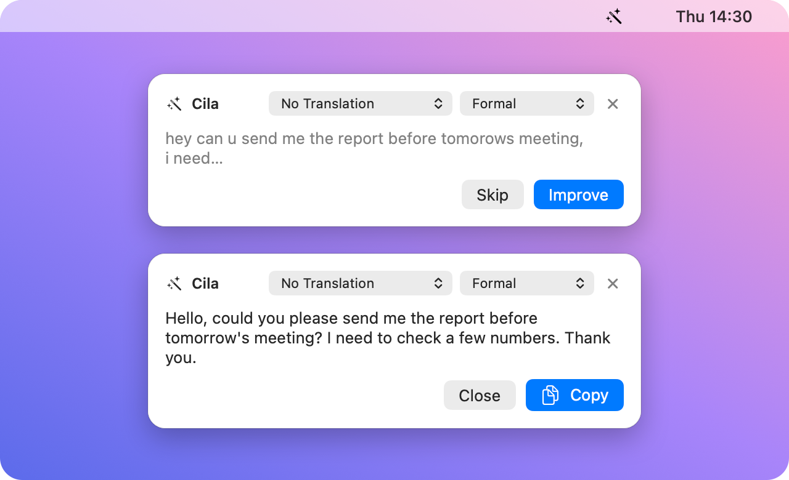

# Cila

Copy any text on your Mac and Cila offers to polish it: grammar, tone, translation, in one click.

<p align="center">
  
</p>

*Cila* is Turkish for "polish".

## Features

- **Works everywhere:** It watches the clipboard, so you don't need Accessibility
  permission or a per-app integration.
- **Stays out of your way:**
  - The panel never takes focus from the app you are typing in.
  - It disappears on its own if you ignore it.
  - It only appears for text that reads like natural language. Code, logs, terminal
    output, tables, URLs, emails, file paths, numbers, IDs, menu labels, short snippets
    and password-manager copies are ignored. Detection combines heuristics with Apple's
    NaturalLanguage framework.
- **No wasted tokens:** Nothing is sent to the LLM unless you click **Improve**.
- **Translation:** You can pick a target language, and text is improved and translated
  into it. Text that is already in that language is only improved.
- **Tone:** Original, Very Formal, Formal, Casual or Very Casual. For languages with
  formal and informal address (siz/sen, Sie/du, vous/tu), the right form is used.
- **Change it per text:** The default language and tone are set in Settings. You can
  change them from the panel for a single text, and the result updates automatically.
- **Improve Text window:** Type or paste anything and improve it without copying it
  first.
- **Any OpenAI-compatible API:** OpenAI, DeepSeek, Claude, OpenRouter, Ollama (local) or
  a custom endpoint. You provide a Base URL, API key and model name.
- **Pause/Resume:** Turn clipboard watching off and on from the menu bar or with ⌃⌥P
  from any app. Cila can also launch at login.

## Requirements

- macOS 14 Sonoma or later
- Xcode 15+ or the Swift 5.9+ toolchain (only to build from source)
- An API key for one of the supported providers, or a local [Ollama](https://ollama.com)
  install

## Build and run

```sh
git clone https://github.com/talhasch/cila.git
cd cila
./build.sh            # debug build → build/Cila.app
open build/Cila.app
```

For a release build installed to `/Applications`:

```sh
./build.sh release
cp -R build/Cila.app /Applications/
open /Applications/Cila.app
```

Install it to `/Applications` if you want **Launch at login**. The login item points to
the app's location, and `build/` is recreated on every build.

`build.sh` builds the Swift package and assembles an ad-hoc signed `Cila.app` bundle. It
adds `Info.plist` (menu-bar-only, no Dock icon) and the app icon.

## First run

1. **Setup window:** It opens automatically. Choose a provider; the Base URL is filled in
   for you. Then enter your API key and a model name, for example a chat model your
   provider offers. Use **Test Connection** to check everything works.
2. **Target language:** Optionally choose one, or skip.
3. **Start using it:** Copy some text anywhere. The panel appears; click **Improve** and
   then **Copy**.

Everything can be changed later from the menu bar icon → **Settings…**

## Usage

| Where | What you can do |
|-------|-----------------|
| Panel (after copying text) | Pick language and tone, **Improve**, **Copy**, **Skip** / ✕ |
| Menu bar → **Improve Text…**, or **⌃⌥N** anywhere | Type or paste text; ⌘↩ to improve, ⇧⌘C to copy |
| Menu bar → **Pause / Resume**, or **⌃⌥P** anywhere | Stop or resume clipboard watching |
| Menu bar → **Settings…** | Launch at login, default language and tone, provider |

## Privacy and security

- Copied text leaves your Mac only when you click **Improve**. It goes only to the
  provider you configured.
- Clipboard items that password managers mark as concealed or transient are never read.
- The API key is stored in `~/Library/Application Support/Cila/credentials.json`. The
  directory and file are readable only by your user (permissions 0700 and 0600). Other
  settings are kept in UserDefaults.

  The Keychain is deliberately not used. Locally built apps have no Apple Team ID, so
  macOS ties Keychain access to each build's code signature and would ask for permission
  on every launch.

## Development

```sh
swift build                        # compile
swift test                         # unit tests (text filter corpus, prompt building)
swift scripts/make-icon.swift      # regenerate Resources/AppIcon.icns
```

Project layout:

```
Sources/Cila/
  main.swift, AppDelegate.swift   App entry, menu bar item, main menu
  AppState.swift                  Pause state
  Clipboard/                      Clipboard polling, TextFilter, ProseDetector
  Panel/                          Non-activating floating panel (AppKit + SwiftUI)
  LLM/                            OpenAI-compatible client, prompt, shared improve/copy
  Settings/                       Settings store, providers, tone, languages,
                                  credential file, launch at login
  Windows/                        Setup, Settings and Improve Text windows
Tests/CilaTests/                  Unit tests
Resources/                        Info.plist, AppIcon.icns
scripts/make-icon.swift           Draws the app icon
SPEC.md                           Full behaviour specification
```

To make the clipboard filter stricter or looser, add the misclassified text to
`Tests/CilaTests/TextFilterTests.swift` first. Then adjust `TextFilter` or
`ProseDetector` until `swift test` passes.

See [SPEC.md](SPEC.md) for the detailed behaviour, thresholds and prompt wording.
